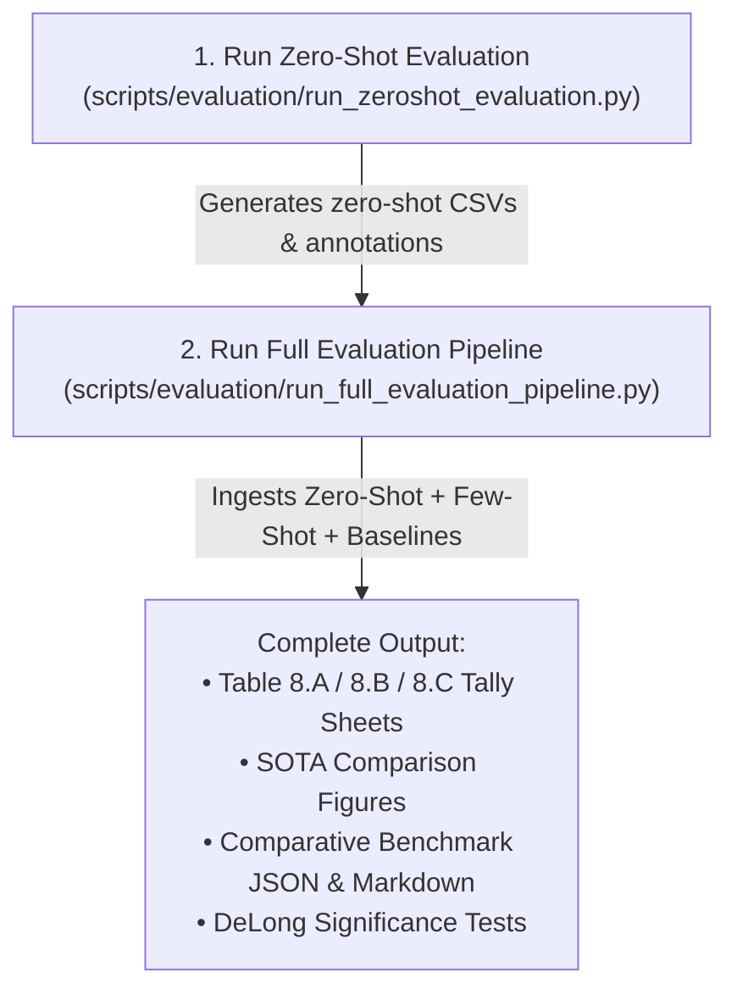

# DeepSentinel Evaluation Guide: Zero-Shot & Few-Shot Benchmarking

Gabay ito para sa pagsasagawa ng evaluation benchmark sa **FakeAVCeleb** (700 clips: 350 Real, 350 Fake) gamit ang updated decision threshold na **$\tau = 0.50$** at paghahambing sa pagitan ng **Zero-Shot** at **Few-Shot (Adapted)** models laban sa mga published SOTA baselines.

---

## 1. Mga Kailangang Ihanda (Pre-requisites)

Bago simulan ang evaluation, tiyaking kumpleto at nasa tamang lokasyon ang mga sumusunod:

### A. Git Branch
Siguraduhing naka-checkout sa bagong branch na naglalaman ng updated evaluation pipeline:
```bash
git fetch origin
git checkout eval-threshold-0.5-zeroshot
git pull origin eval-threshold-0.5-zeroshot
```

### B. Checkpoints (`.pt` files)
Kailangan ang dalawang model checkpoints mula sa Google Drive / storage:
1. **Zero-Shot Model:** `best_phase2_bottleneck.pt` (Base Stage 2 checkpoint bago ang adaptation)
2. **Few-Shot / Adapted Model:** `best_phase2_adapted.pt` (Speaker-disjoint calibrated model)

> [!NOTE]
> Ilagay ang mga checkpoints sa `checkpoints/` (o `checkpoints/full/`).
> Halimbawa:
> - `checkpoints/best_phase2_bottleneck.pt`
> - `checkpoints/best_phase2_adapted.pt`

### C. Test Dataset & Preprocessed Feature Cache
- **Evaluation Manifest:** `data/manifests/fakeavceleb_eval_350_350.csv`
- **Cached Feature Tensors:** Kung mayroon nang extracted preprocessed features sa `data/preprocessed/`, mas mabilis ang evaluation gamit ang `--cached_only`. Kung wala, kailangang accessible ang raw MP4 files.

### D. Baseline SOTA CSVs
Tiyaking nandoon ang limang baseline CSV files sa `data/eval_results/external_sota/`:
- `mesonet_fakeavceleb_eval.csv`
- `xception_fakeavceleb_eval.csv`
- `resnet_av_fakeavceleb_eval.csv`
- `lipforensics_fakeavceleb_eval.csv`
- `acenet_fakeavceleb_eval.csv`

---

## 2. Pagkakasunod-sunod ng Pagpapatakbo (Execution Steps)

Dalawang script lamang ang kailangang patakbuhin nang sunod:



### HAKBANG 1: Patakbuhin ang Zero-Shot Evaluation (Una)
Ine-evaluate nito ang unadapted bottleneck model sa 700 clips sa threshold na 0.50 at naglalabas ng sariling predictions, confusion matrix, at sensitivity table.

```bash
python scripts/evaluation/run_zeroshot_evaluation.py \
    --checkpoint checkpoints/best_phase2_bottleneck.pt \
    --device cuda
```
*(Kung nasa `checkpoints/full/` ang inyong checkpoint, palitan ang path sa `--checkpoint`).*

---

### HAKBANG 2: Patakbuhin ang Full Pipeline (Pangalawa)
Ine-evaluate nito ang few-shot adapted model (`best_phase2_adapted.pt`) at awtomatikong kinukuha ang nagawang zero-shot outputs mula sa Hakbang 1 upang buuin ang kumpletong comparative tables, plots, at statistical tests.

```bash
python scripts/evaluation/run_full_evaluation_pipeline.py \
    --checkpoint checkpoints/best_phase2_adapted.pt \
    --device cuda
```

> [!TIP]
> **Kung natapos na ang model inference dati** at nais lamang buuin muli ang mga tally sheets, plots, at benchmark markdown nang hindi nagpapatakbo ng GPU inference, gamitin ang `--skip_inference` flag:
> ```bash
> python scripts/evaluation/run_full_evaluation_pipeline.py --skip_inference
> ```

---

## 3. Checklist ng Inaasahang Output (Verification)

Pagkatapos ng Hakbang 2, tiyaking kumpleto ang mga files sa mga sumusunod na lokasyon:

### Mga Tally Sheets at Markdown Tables:
- [ ] `docs/TABLE_8A_FAKEAVCELEB_700_CLIPS.md` — Naglalaman ng comparison columns para sa Few-Shot at Zero-Shot ($\tau = 0.50$, 700 clips).
- [ ] `data/eval_results/table_8a_fakeavceleb_700.csv` (700 rows)
- [ ] `docs/TABLE_8B_CREMAD_700_CLIPS.md` & `data/eval_results/table_8b_cremad_700.csv`
- [ ] `docs/TABLE_8C_MUSTARD_690_CLIPS.md` & `data/eval_results/table_8c_mustard_690.csv`
- [ ] `docs/FILLED_EXPERIMENT_PAPER_RESULTS.md` — Na-update ang Part 3 kasama ang Zero-Shot tally data.

### SOTA Benchmark at Statistical Tests:
- [ ] `data/eval_results/comparative_benchmark_data.json` — Naglalaman ng metrics at DeLong tests para sa parehong Few-Shot at Zero-Shot laban sa mga baselines.
- [ ] `docs/comparative_sota_benchmark_reference.md` — Reference table na may AUC 95% CI at statistical significance flags ($p < 0.001$).

### Mga Figure at Graph:
Tiyaking na-generate ang plots sa `data/eval_results/figures_comparative/`:
- [ ] `comparative_roc_curves.png` (May curve ang parehong Few-Shot at Zero-Shot)
- [ ] `comparative_multimetric_barchart.png`
- [ ] `comparative_method_breakdown.png`
- [ ] `thesis_master_comparative_dashboard.png`

---

## 4. Pag-troubleshoot (Common Issues)

1. **`FileNotFoundError: Checkpoint not found`**
   - Tingnan kung nasa tamang directory ang `.pt` file. Gamitin ang `find . -name "best_phase2_*.pt"` para malaman ang eksaktong lokasyon.
2. **`CUDA Out of Memory (OOM)`**
   - Magdagdag ng parameter na `--batch_size 8` o `--batch_size 4` sa command kung kinakapos ang VRAM ng GPU.
3. **`Row count mismatch error`**
   - Tiyaking ang `fakeavceleb_eval_350_350.csv` manifest ay may eksaktong 700 clips. May built-in assertion ang pipeline na mag-e-error kapag kulang o sumobra ang bilang ng clips.

