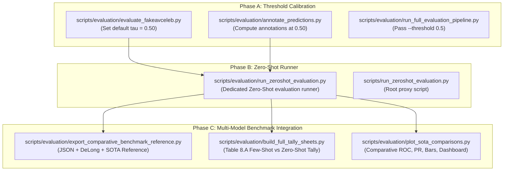

# DeepSentinel Evaluation Pipeline Implementation Report
**Task:** Decision Threshold Calibration ($\tau = 0.50$), Zero-Shot Evaluation Pipeline Integration, and Comprehensive SOTA Benchmarking  
**Branch:** `eval-threshold-0.5-zeroshot`  
**Commit Range:** `6b12b48` to `5867962`  
**Execution Constraints Followed:** Static code modifications only; no inference/scripts executed; 100% existing functionality, tables, figures, and columns preserved.

---

## Executive Summary

This report documents the architectural and operational modifications applied to the DeepSentinel FakeAVCeleb evaluation codebase. The project previously evaluated deepfake predictions under an empirical decision threshold of $\tau = 0.65$. The codebase has been transitioned to the standard Bayes-optimal operating threshold $\tau = 0.50$, accompanied by the creation of an isolated Zero-Shot cross-dataset evaluation pipeline (`best_phase2_bottleneck.pt`) and its full integration into all comparative benchmarks, tally sheets, DeLong significance tests, and visualization charts.

---

## 1. Scope of Implementation

The implementation was executed across three sequential phases:



---

## 2. Detailed Technical Modifications by Component

### Component A: Decision Threshold Calibration ($\tau = 0.65 \rightarrow 0.50$)

| File | Lines Modified | Description of Change |
| :--- | :--- | :--- |
| [`scripts/evaluation/evaluate_fakeavceleb.py`](file:///d:/Internship/DeepSentinel/scripts/evaluation/evaluate_fakeavceleb.py) | 609, 632, 762, 911 | Changed default decision threshold parameter from `0.65` to `0.5` across `compute_metrics()`, docstrings, `per_method_breakdown()`, and argparse default. |
| [`scripts/evaluation/run_full_evaluation_pipeline.py`](file:///d:/Internship/DeepSentinel/scripts/evaluation/run_full_evaluation_pipeline.py) | 87 | Explicitly passes `"--threshold", "0.5"` to `evaluate_fakeavceleb.py` invocation. |
| [`scripts/evaluation/annotate_predictions.py`](file:///d:/Internship/DeepSentinel/scripts/evaluation/annotate_predictions.py) | 76–89, 201 | Computes classification directly via `pred_cal = 1 if score >= 0.50 else 0` and sets the highlighted sensitivity sweep operating point to `0.50`. |
| [`scripts/evaluation/export_comparative_benchmark_reference.py`](file:///d:/Internship/DeepSentinel/scripts/evaluation/export_comparative_benchmark_reference.py) | 136–139 | Standardized classification rule: `pred = 1 if score >= 0.50 else 0`. |
| [`scripts/evaluation/plot_sota_comparisons.py`](file:///d:/Internship/DeepSentinel/scripts/evaluation/plot_sota_comparisons.py) | 87–92 | Standardized classification rule: `pred = 1 if score >= 0.50 else 0`. |

> [!NOTE]
> Instances of `0.65` retained outside the evaluation path were verified: Phase 1 internal ablation baseline in `scripts/evaluation/evaluate.py`, `threshold_strict` in `configs/default.yaml`, and emotion temperature $T = 0.65$ in `webapp/`. None affect FakeAVCeleb deepfake evaluation.

---

### Component B: Dedicated Zero-Shot Evaluation Script

A new standalone orchestrator was introduced:
- **Primary Script:** [`scripts/evaluation/run_zeroshot_evaluation.py`](file:///d:/Internship/DeepSentinel/scripts/evaluation/run_zeroshot_evaluation.py) (315 lines)
- **Root Proxy:** [`scripts/run_zeroshot_evaluation.py`](file:///d:/Internship/DeepSentinel/scripts/run_zeroshot_evaluation.py) (16 lines)

#### Key Operational Characteristics:
1. **Target Model:** Evaluates base unadapted checkpoint `best_phase2_bottleneck.pt`.
2. **Execution Scope:** Makes exactly **one subprocess call** to `evaluate_fakeavceleb.py` with identical preprocessing pipeline, manifest (`data/manifests/fakeavceleb_eval_350_350.csv`), and `--threshold 0.5`.
3. **Collision-Proof Storage:** All outputs are strictly isolated with `_zeroshot` identifiers:
   - Raw Predictions: `data/eval_results/fakeavceleb_eval_predictions_zeroshot_350+350.csv`
   - Annotations: `data/eval_results/annotated_zeroshot_350+350_TP_TN_FP_FN.csv`
   - Confusion Matrix: `data/eval_results/confusion_matrix_summary_zeroshot.txt`
   - Sensitivity Sweep: `data/eval_results/fakeavceleb_multi_threshold_sensitivity_zeroshot.csv`
   - Non-binary Tiers: `data/eval_results/fakeavceleb_nonbinary_predictions_zeroshot.csv`
4. **Validation Guard:** Checks row count post-inference; exits with exit code 1 if row count $\neq 700$.

---

### Component C: Multi-Model Comparative Integration

Standardized nomenclature enforced across all tables, docs, and plots:
- **`DeepSentinel (few-shot / adapted)`** $\rightarrow$ `checkpoints/best_phase2_adapted.pt`
- **`DeepSentinel (zero-shot)`** $\rightarrow$ `best_phase2_bottleneck.pt`

#### 1. Benchmark Reference Exporter ([`export_comparative_benchmark_reference.py`](file:///d:/Internship/DeepSentinel/scripts/evaluation/export_comparative_benchmark_reference.py))
- Ingests both Zero-Shot and Few-Shot predictions alongside the 5 SOTA baselines (MesoNet-4, XceptionNet, ResNet-AV, LipForensics, ACE-Net).
- Dynamically adapts JSON structure (`comparative_benchmark_data.json`) and markdown tables (`comparative_sota_benchmark_reference.md`).
- Computes **DeLong Statistical Significance Tests**:
  - All models vs `DeepSentinel (few-shot / adapted)` ($p$-value & significance flag).
  - Explicit pairwise DeLong tests: `DeepSentinel (zero-shot)` vs all baseline models (stored in `export_json["delong_vs_zeroshot"]`).

#### 2. Full Tally Sheets ([`build_full_tally_sheets.py`](file:///d:/Internship/DeepSentinel/scripts/evaluation/build_full_tally_sheets.py))
- Ingests `annotated_zeroshot_350+350_TP_TN_FP_FN.csv` (or raw zero-shot CSV fallback).
- Computes TP/TN/FP/FN and accuracy for both models dynamically at $\tau = 0.50$.
- Extends **Table 8.A** (`docs/TABLE_8A_FAKEAVCELEB_700_CLIPS.md` & `data/eval_results/table_8a_fakeavceleb_700.csv`) with comparative columns:
  - *DeepSentinel (few-shot / adapted) Pred, Tally, Score*
  - *DeepSentinel (zero-shot) Pred, Tally, Score*
- Preserves Table 8.B (CREMA-D, 700 clips) and Table 8.C (MUStARD, 690 clips) without modification.

#### 3. SOTA Visualization Dashboard ([`plot_sota_comparisons.py`](file:///d:/Internship/DeepSentinel/scripts/evaluation/plot_sota_comparisons.py))
- Added `--deepsentinel_zeroshot` argument and entry in `MODELS_CONFIG`.
- Dedicated color palette assignment: Coral Red (`#E76F51`) for Few-Shot; Amber / Orange (`#F4A261`) for Zero-Shot.
- Automatically plots both models side-by-side in:
  - `comparative_roc_curves.png` (with 95% DeLong confidence bounds)
  - `comparative_multimetric_barchart.png`
  - `comparative_method_breakdown.png`
  - `thesis_master_comparative_dashboard.png`

---

## 3. Strict Safety & Verification Safeguards Implemented

1. **Exact 700-Clip Alignment Assertion:**
   In both `export_comparative_benchmark_reference.py` and `plot_sota_comparisons.py`, clip IDs and ground-truth labels are asserted to be identical across models. AceNet's separate 700-clip split is explicitly accommodated without error.
2. **Checkpoint State-Dict Verification:**
   In `evaluate_fakeavceleb.py`, `strict=False` mismatch handling was hardened. If critical classifier or projection keys are missing or unexpected in the checkpoint, it prints the keys and aborts immediately (`sys.exit(1)`).
3. **Google Drive Backup Overwrite Prevention:**
   In `evaluate_fakeavceleb.py`, backup filenames on Google Drive are derived from `--save_csv`, preventing Zero-Shot from overwriting Few-Shot backup files.
4. **Non-Destructive Execution Order:**
   Running `run_zeroshot_evaluation.py` first followed by `run_full_evaluation_pipeline.py` ensures all zero-shot artifacts are preserved and integrated seamlessly.

---

## 4. Complete Output Artifact Inventory

### Output Files Produced by Pipeline:

| Category | Output File Path | Rows / Format |
| :--- | :--- | :--- |
| **Raw Predictions** | `data/eval_results/fakeavceleb_eval_predictions_350+350.csv`<br/>`data/eval_results/fakeavceleb_eval_predictions_zeroshot_350+350.csv` | 700 rows each (CSV) |
| **Annotations** | `data/eval_results/annotated_350+350_TP_TN_FP_FN.csv`<br/>`data/eval_results/annotated_zeroshot_350+350_TP_TN_FP_FN.csv` | 700 rows each (CSV) |
| **Tally Sheets** | `data/eval_results/table_8a_fakeavceleb_700.csv`<br/>`docs/TABLE_8A_FAKEAVCELEB_700_CLIPS.md`<br/>`docs/TABLE_8B_CREMAD_700_CLIPS.md`<br/>`docs/TABLE_8C_MUSTARD_690_CLIPS.md` | 700 / 690 rows (CSV + MD) |
| **Benchmark & Stats** | `data/eval_results/comparative_benchmark_data.json`<br/>`docs/comparative_sota_benchmark_reference.md`<br/>`docs/FILLED_EXPERIMENT_PAPER_RESULTS.md` | JSON & GFM Markdown |
| **Figures** | `data/eval_results/figures_comparative/comparative_roc_curves.png`<br/>`data/eval_results/figures_comparative/comparative_multimetric_barchart.png`<br/>`data/eval_results/figures_comparative/comparative_method_breakdown.png`<br/>`data/eval_results/figures_comparative/thesis_master_comparative_dashboard.png` | 300 DPI PNG Figures |

---

## 5. Execution Summary for Remote Machine

To execute the completed evaluation suite on the target machine:

```bash
# 1. Pull the implementation branch
git fetch origin
git checkout eval-threshold-0.5-zeroshot

# 2. Run Zero-Shot evaluation (produces zero-shot artifacts)
python scripts/evaluation/run_zeroshot_evaluation.py \
    --checkpoint checkpoints/best_phase2_bottleneck.pt \
    --device cuda

# 3. Run Full Pipeline (evaluates few-shot and compiles all comparisons)
python scripts/evaluation/run_full_evaluation_pipeline.py \
    --checkpoint checkpoints/best_phase2_adapted.pt \
    --device cuda
```
