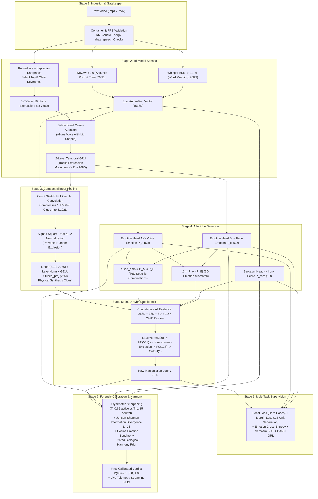

# DeepSentinel: Complete 7-Stage System Architecture, Intuitive Mechanics & Codebase Execution Guide

> **Official Thesis Title:** *A Multimodal Deepfake Detection Framework Leveraging Bilinear Pooling and Emotion Mismatch*  
> **Institutional Affiliation:** Polytechnic University of the Philippines — Department of Computer Science (BSCS 2026)  
> **Research Authors:** Cabral, Shikina Y. | Caparas, John Christian B. | Exconde, Matan John B. | Rivera, Geuel John D.  
> **Purpose of this Master Guide:** A comprehensive, plain-English breakdown of how the DeepSentinel system works from start to finish. Focuses purely on system mechanics, intuitive layman analogies, step-by-step mathematical explanations with **complete variable-by-variable glossaries**, and exact source code block mappings across the canonical **7-Stage Pipeline**.

---

# Table of Contents
1. [The Big Picture: Why DeepSentinel Works](#1-the-big-picture-why-deepsentinel-works)
2. [High-Level 7-Stage Architecture Flowchart](#2-high-level-7-stage-architecture-flowchart)
3. [The Canonical 7 Stages: Layman Intuition, Variable-by-Variable Math & Code Mapping](#3-the-canonical-7-stages-layman-intuition-variable-by-variable-math--code-mapping)
   - [Stage 1: Ingestion & The Silent Gatekeeper](#stage-1-ingestion--the-silent-gatekeeper)
   - [Stage 2: The Tri-Modal Senses (Ears, Brain, Eyes)](#stage-2-the-tri-modal-senses-ears-brain-eyes)
   - [Stage 3: Compact Bilinear Pooling (The Multiplicative Blender & Compressor)](#stage-3-compact-bilinear-pooling-the-multiplicative-blender--compressor)
   - [Stage 4: Multi-Task Emotion & Sarcasm Heads (The Affect Lie Detectors)](#stage-4-multi-task-emotion--sarcasm-heads-the-affect-lie-detectors)
   - [Stage 5: The 299D Multi-Scale Hybrid Bottleneck Classifier](#stage-5-the-299d-multi-scale-hybrid-bottleneck-classifier)
   - [Stage 6: Multi-Task Loss Objective & Supervised Margin Separation](#stage-6-multi-task-loss-objective--supervised-margin-separation)
   - [Stage 7: Forensic Calibration & The Gated Biological Harmony Prior](#stage-7-forensic-calibration--the-gated-biological-harmony-prior)
4. [Cross-Subsystem Interactions & Lifecycle Choreography](#4-cross-subsystem-interactions--lifecycle-choreography)
5. [Master Codebase Navigation Matrix](#5-master-codebase-navigation-matrix)

---

# 1. The Big Picture: Why DeepSentinel Works

### The Fundamental Flaw of Traditional Detectors
> **The Invisible Brushstrokes:** Imagine trying to spot a forged painting. Older art forgeries had obvious visual flaws—smudged paint, weird colors, or glue marks along the edges. Traditional deepfake detectors were built like magnifying glasses looking for those blurry edges or pixel glitches.  
> But modern generative AI (like MuseTalk, Sora, or EMO) is now so advanced that it produces **crystal-clear, photorealistic video**. There are no blurry seams or pixel glitches left to find. If a detector only looks at image quality, it will be fooled.

### DeepSentinel's Solution: Inspecting Emotional Harmony
> **The Neurobiological Acting Flaw:** Real human communication is a synchronized biological reflex. When a person is genuinely terrified, furious, or overjoyed:
> 1. Their vocal pitch and tremor (Acoustics)
> 2. The words and sentiment they choose (Language)
> 3. Their facial muscles—eyebrows, eyes, lips (Visual Expression)  
> ...are hard-wired by the human nervous system to fire **at the exact same time**.
> 
> Deepfake creators build fake videos in **separate, disconnected steps**:
> - **Step A:** An AI clones a voice.
> - **Step B:** Another AI forces the lips to move to that audio.
> - **Step C:** Another AI swaps the face onto someone else's body.  
> 
> Because these generative tools work in isolation, they create an **emotional mismatch**—such as a furious, screaming voice coming out of a smiling or emotionless face.  
> **DeepSentinel detects deepfakes by measuring this cross-modal emotional mismatch ($\boldsymbol{\Delta}$).**

---

# 2. High-Level 7-Stage Architecture Flowchart



---

# 3. The Canonical 7 Stages: Layman Intuition, Variable-by-Variable Math & Code Mapping

---

## Stage 1: Ingestion & The Silent Gatekeeper

### 1. Layman Intuition & Analogy
> **The Bouncer at the Door:** Imagine a bouncer checking visitors outside a courtroom. If a person enters who is completely silent or muted, the bouncer tells the lie-detector machine: *"This person hasn't spoken a single word; do not treat their microphone background hiss or heavy breathing as a confession."*  
> If an AI tries to transcribe pure silence, it gets confused and hallucinates random words. Stage 1 checks whether real sound energy exists. If the audio is below the speech threshold, it flags `has_speech = False`, grounds the vocal emotion to 100% neutral, and prevents false alarms.

### 2. Variable-by-Variable Mathematical Breakdown

#### Equation 1.1: Root Mean Square (RMS) Audio Energy
$$E_{\text{RMS}} = \sqrt{\frac{1}{N}\sum_{i=1}^{N} x_i^2}$$

##### Variable & Symbol Breakdown:
| Symbol | Type / Shape | What is it? (Layman Definition) | What is it doing in the equation? (Mathematical Role) |
| :--- | :--- | :--- | :--- |
| $E_{\text{RMS}}$ | Scalar $\in [0.0, 1.0]$ | The true physical loudness/energy of the audio track. | The output value representing average electrical power. |
| $x_i$ | Float $\in [-1.0, 1.0]$ | The height/amplitude of the audio wave at the $i$-th time tick. | Raw microphone air pressure reading (sampled 16,000 times/sec). |
| $x_i^2$ | Float $\ge 0.0$ | The squared wave height. | Eliminates negative wave troughs so all wave energy adds up positively. |
| $N$ | Integer | Total number of audio ticks in the file (e.g., $80,000$ for a 5.0-second clip). | Denominator used to calculate the average across time. |
| $\sum_{i=1}^N$ | Summation Operator | Loop adding from tick $1$ to tick $N$. | Sums the squared electrical power of every individual sample. |
| $\frac{1}{N}$ | Arithmetic Mean | Dividing the sum by count $N$. | Calculates mean power (prevents long clips from appearing louder than short ones). |
| $\sqrt{\dots}$ | Square Root Operator | Square root function. | Converts squared power units back to the linear wave amplitude scale. |

---

#### Equation 1.2: Decibel Conversion & The Speech Presence Gate
$$\text{dBFS} = 20 \cdot \log_{10}\big(E_{\text{RMS}} + 10^{-9}\big)$$
$$\text{has\_speech} = \begin{cases} \text{True}, & \text{if } \text{dBFS} \ge -42.0\text{ dB} \\ \text{False}, & \text{if } \text{dBFS} < -42.0\text{ dB} \quad (\text{Silent / Quiet Video Policy}) \end{cases}$$

##### Variable & Symbol Breakdown:
| Symbol | Type / Shape | What is it? (Layman Definition) | What is it doing in the equation? (Mathematical Role) |
| :--- | :--- | :--- | :--- |
| $\text{dBFS}$ | Float $\le 0.0\text{ dB}$ | Decibels relative to Full Scale. | Converts linear energy into the logarithmic hearing scale of human ears. |
| $20 \cdot \log_{10}(\dots)$ | Logarithmic Scaling | Base-10 logarithm multiplier. | Transforms wave amplitude ratios into standard audio decibels ($0\text{ dB}$ is max digital loudness). |
| $10^{-9}$ | Epsilon constant | A tiny float ($0.000000001$). | Prevents $\log_{10}(0)$ mathematical crashes on 100% muted silent audio. |
| $-42.0\text{ dB}$ | Constant Threshold | The boundary between speech and quiet background noise. | Decision cut-off: any sound quieter than $-42\text{ dB}$ is ambient hiss, not human voice. |
| $\text{has\_speech}$ | Boolean (`True`/`False`) | Flag passed to downstream neural models. | When `False`, forces vocal emotion to 100% Neutral, $\boldsymbol{\Delta}=0$, and $P_{\text{sarc}}=0$. |

### 3. Exact Codebase Mapping
* **File:** [`webapp/input_validator.py`](file:///d:/Internship/DeepSentinel/webapp/input_validator.py)
* **Code Blocks:**
  * `validate_container(file_path)` ([Lines 45–105](file:///d:/Internship/DeepSentinel/webapp/input_validator.py#L45-L105)): Validates video format and aspect ratio using OpenCV.
  * `validate_audio_track(file_path)` ([Lines 178–235](file:///d:/Internship/DeepSentinel/webapp/input_validator.py#L178-L235)): Decodes audio using `soundfile.read(dtype='float32')` (avoiding Windows C++ DLL crashes seen in `torchaudio.load()`).
  * `validate_speech_presence(audio_path, threshold_db=-42.0)` ([Lines 238–290](file:///d:/Internship/DeepSentinel/webapp/input_validator.py#L238-L290)): Computes Equations 1.1 and 1.2.

---

## Stage 2: The Tri-Modal Senses (Ears, Brain, Eyes)

### 1. Layman Intuition & Analogy
> **The 3 Specialized Investigators:**
> - **Investigator 1 (The Ears — Wav2Vec 2.0):** Listens strictly to the acoustic tone—pitch fluctuations, speed, trembling, volume spikes, and voice strain.
> - **Investigator 2 (The Brain — Whisper + BERT):** Transcribes the speech into text and understands the emotional meaning of the words (e.g., *"I am so happy"* vs. *"This is terrible"*).
> - **Investigator 3 (The Eyes — RetinaFace + ViT + GRU):** Finds the face, ignores motion blur, picks the 8 clearest keyframes, and watches how facial expressions move over time (e.g., the speed of an eyebrow raise or a smile forming).

### 2. Variable-by-Variable Mathematical Breakdown

#### Equation 2.1: Optical Flow Motion Gating
$$\mu_{\text{motion}}(t) = \frac{1}{H \times W} \sum_{x=1}^H \sum_{y=1}^W \sqrt{\big(u(x, y, t)\big)^2 + \big(v(x, y, t)\big)^2} \ge 0.30$$

##### Variable & Symbol Breakdown:
| Symbol | Type / Shape | What is it? (Layman Definition) | What is it doing in the equation? (Mathematical Role) |
| :--- | :--- | :--- | :--- |
| $\mu_{\text{motion}}(t)$ | Float $\ge 0.0$ | Average pixel movement speed between frame $t$ and frame $t+1$. | Output motion score used to filter out frozen/static video segments. |
| $H, W$ | Integers | Height and Width of the video frame in pixels. | Frame dimensions used to calculate the spatial average ($H \times W$). |
| $u(x, y, t)$ | Float | Horizontal velocity of the pixel at coordinate $(x, y)$. | Number of pixels the point shifted left or right in $1/25$th of a second. |
| $v(x, y, t)$ | Float | Vertical velocity of the pixel at coordinate $(x, y)$. | Number of pixels the point shifted up or down in $1/25$th of a second. |
| $\sqrt{u^2 + v^2}$ | Euclidean Distance | Pythagorean formula for 2D velocity magnitude. | Converts 2D directional motion $(u, v)$ into a single absolute speed value. |
| $0.30$ | Motion Threshold | Cut-off velocity ($0.30$ pixels/frame). | Any frame with less motion than $0.30$ is skipped as static filler. |

---

#### Equation 2.2: Laplacian Edge Variance (Facial Sharpness)
$$\text{Sharpness}(I_{\text{crop}}) = \text{Var}\Big(\nabla^2 I_{\text{crop}}\Big) = \frac{1}{HW} \sum_{x=1}^H \sum_{y=1}^W \Big(L(x, y) - \bar{L}\Big)^2, \quad \text{where } L(x, y) = \frac{\partial^2 I}{\partial x^2} + \frac{\partial^2 I}{\partial y^2}$$

##### Variable & Symbol Breakdown:
| Symbol | Type / Shape | What is it? (Layman Definition) | What is it doing in the equation? (Mathematical Role) |
| :--- | :--- | :--- | :--- |
| $I_{\text{crop}}$ | Matrix $\in \mathbb{R}^{H \times W}$ | The cropped grayscale image containing only the speaker's face. | Input image matrix on which sharpness is evaluated. |
| $\nabla^2$ | Laplace Operator | Second spatial derivative (edge detector filter). | Measures sudden changes in brightness across neighboring pixels. |
| $L(x, y)$ | Float | Laplacian value at pixel $(x, y)$. | Second-derivative edge strength at that specific pixel location. |
| $\bar{L}$ | Float | Mean Laplacian value across the entire face crop. | Centering constant subtracted to compute statistical variance. |
| $\text{Var}(\dots)$ | Variance Formula | Spread of edge responses across the face. | Blurry faces have smooth transitions (near-0 variance); crisp faces with sharp eyes and lips produce high variance. |

---

#### Equation 2.3: Keyframe Ranking Score
$$S(I_t) = \text{Conf}_{\text{RetinaFace}}(I_t) \times \text{Sharpness}(I_t)$$

##### Variable & Symbol Breakdown:
| Symbol | Type / Shape | What is it? (Layman Definition) | What is it doing in the equation? (Mathematical Role) |
| :--- | :--- | :--- | :--- |
| $S(I_t)$ | Float $\ge 0.0$ | Overall quality and clarity score of frame $t$. | Output ranking metric used to pick the top $K=8$ keyframes. |
| $\text{Conf}_{\text{RetinaFace}}$ | Float $\in [0.0, 1.0]$ | Confidence of the RetinaFace neural detector. | Ensures the image genuinely contains a clear, forward-facing human face. |
| $\text{Sharpness}(I_t)$ | Float $\ge 0.0$ | Laplacian sharpness variance from Equation 2.2. | Rewards crisp, in-focus frames and penalizes motion-blurred frames. |

---

#### Equation 2.4: Bidirectional Multi-Head Cross-Modal Attention
$$\text{Attn}(\mathbf{Q}, \mathbf{K}, \mathbf{V}) = \text{softmax}\left(\frac{\mathbf{Q} \mathbf{K}^T}{\sqrt{d_k}}\right) \mathbf{V}$$
$$\mathbf{Z}_v' = \text{LayerNorm}\Big(\mathbf{Z}_v + \text{MHA}\big(\mathbf{Q}=\mathbf{Z}_v, \mathbf{K}=\mathbf{Z}_{at}, \mathbf{V}=\mathbf{Z}_{at}\big)\Big) \in \mathbb{R}^{8 \times 768}$$
$$\mathbf{Z}_{at}' = \text{LayerNorm}\Big(\mathbf{Z}_{at} + \text{MHA}\big(\mathbf{Q}=\mathbf{Z}_{at}, \mathbf{K}=\mathbf{Z}_v, \mathbf{V}=\mathbf{Z}_v\big)\Big) \in \mathbb{R}^{2 \times 768}$$

##### Variable & Symbol Breakdown:
| Symbol | Type / Shape | What is it? (Layman Definition) | What is it doing in the equation? (Mathematical Role) |
| :--- | :--- | :--- | :--- |
| $\mathbf{Q}$ (Query) | Tensor | What the modality is asking about. | Search vector (e.g., visual face asking: *"Which sound corresponds to this lip shape?"*). |
| $\mathbf{K}$ (Key) | Tensor | The indexing tags of the opposite modality. | Comparison vector used in dot-product $\mathbf{Q}\mathbf{K}^T$ to measure relevance. |
| $\mathbf{V}$ (Value) | Tensor | The actual content/information of the opposite modality. | Information payload blended according to the attention weights. |
| $d_k$ | Integer ($= 96$) | Dimension of each attention head ($768 / 8 = 96$). | Scaling factor $\sqrt{d_k} \approx 9.79$ preventing numerical explosion in softmax. |
| $\mathbf{Z}_v$ | Tensor $(8 \times 768)$ | 8 sequential face embeddings from ViT-Base/16. | Input visual tokens representing the 8 keyframes. |
| $\mathbf{Z}_{at}$ | Tensor $(2 \times 768)$ | Combined acoustic (token 0) and linguistic (token 1) vector. | Input audio-text tokens representing voice and transcript. |
| $\text{LayerNorm}$ | Normalization Layer | Standard layer normalization ($\mu=0, \sigma=1$). | Stabilizes activations across attention residual connections. |

---

#### Equation 2.5: 2-Layer Temporal GRU (Expression Dynamics)
$$\mathbf{r}_t = \sigma\big(\mathbf{W}_{ir} \mathbf{x}_t + \mathbf{b}_{ir} + \mathbf{W}_{hr} \mathbf{h}_{t-1} + \mathbf{b}_{hr}\big) \quad (\text{Reset Gate: what past context to forget})$$
$$\mathbf{z}_t = \sigma\big(\mathbf{W}_{iz} \mathbf{x}_t + \mathbf{b}_{iz} + \mathbf{W}_{hz} \mathbf{h}_{t-1} + \mathbf{b}_{hz}\big) \quad (\text{Update Gate: what new facial change to remember})$$
$$\mathbf{n}_t = \tanh\Big(\mathbf{W}_{in} \mathbf{x}_t + \mathbf{b}_{in} + \mathbf{r}_t \odot (\mathbf{W}_{hn} \mathbf{h}_{t-1} + \mathbf{b}_{hn})\Big) \quad (\text{Candidate Expression Memory})$$
$$\mathbf{h}_t = (1 - \mathbf{z}_t) \odot \mathbf{n}_t + \mathbf{z}_t \odot \mathbf{h}_{t-1} \quad (\text{Updated Temporal State})$$

##### Variable & Symbol Breakdown:
| Symbol | Type / Shape | What is it? (Layman Definition) | What is it doing in the equation? (Mathematical Role) |
| :--- | :--- | :--- | :--- |
| $\mathbf{x}_t$ | Vector $\in \mathbb{R}^{768}$ | Attended visual face embedding at frame step $t \in \{1,\dots,8\}$. | Input token for the current keyframe. |
| $\mathbf{h}_{t-1}, \mathbf{h}_t$ | Vectors $\in \mathbb{R}^{768}$ | Hidden state memory of the GRU (past vs. updated). | Rolling memory holding the trajectory of facial muscle movement over time. |
| $\mathbf{r}_t$ | Vector $\in (0, 1)^{768}$ | Reset Gate vector. | Determines how much past facial context to discard when an expression suddenly shifts. |
| $\mathbf{z}_t$ | Vector $\in (0, 1)^{768}$ | Update Gate vector. | Determines how much of the new keyframe $\mathbf{x}_t$ should update the running memory. |
| $\mathbf{n}_t$ | Vector $\in (-1, +1)^{768}$ | Candidate new memory vector. | Non-linear $\tanh$ transformation proposing the updated expression state. |
| $\mathbf{W}, \mathbf{b}$ | Matrices & Biases | Learned neural network parameters. | Projects input features into the gate spaces. |
| $\odot$ | Hadamard Product | Element-by-element multiplication. | Applies the gating filters directly channel-by-channel. |
| $\mathbf{Z}_v = \mathbf{h}_8$ | Vector $\in \mathbb{R}^{768}$ | The final visual vector from the 8th frame. | Aggregate output encoding the full temporal micro-expression trajectory. |

### 3. Exact Codebase Mapping
* **Audio:** [`src/preprocessing/audio.py:L125-165`](file:///d:/Internship/DeepSentinel/src/preprocessing/audio.py#L125-L165) (`get_acoustic_embedding`), [Lines 102–123](file:///d:/Internship/DeepSentinel/src/preprocessing/audio.py#L102-L123) (`transcribe_with_meta`), [Lines 168–195](file:///d:/Internship/DeepSentinel/src/preprocessing/audio.py#L168-L195) (`get_linguistic_embedding`), [Lines 198–230](file:///d:/Internship/DeepSentinel/src/preprocessing/audio.py#L198-L230) (`get_z_at`).
* **Visual & Temporal:** [`src/preprocessing/visual.py:L120-210`](file:///d:/Internship/DeepSentinel/src/preprocessing/visual.py#L120-L210) (`detect_faces_retinaface`), [Lines 260–345](file:///d:/Internship/DeepSentinel/src/preprocessing/visual.py#L260-L345) (`select_keyframes`), [`src/models/detection_model.py:L388-407`](file:///d:/Internship/DeepSentinel/src/models/detection_model.py#L388-L407) (`cross_attn_v`, `cross_attn_at`, `vit_gru`).

---

## Stage 3: Compact Bilinear Pooling (The Multiplicative Blender & Compressor)

### 1. Layman Intuition & Analogy
> **The Multiplicative Blender & Compressor:**  
> If you combine audio and visual clues by simply stacking them side-by-side (concatenation: $1536 + 768 = 2304$), the computer treats audio and video as two parallel lines that never cross.  
> To capture true cross-modal interactions, we must multiply every audio clue with every visual clue. But multiplying $1,536 \times 768$ creates **1,179,648 combinations**—over 1.1 million numbers for a single clip! This causes computers to run out of memory and overfit to background noise.  
> **Compact Bilinear Pooling (CBP)** uses frequency mathematics (Fast Fourier Transform) to compress all 1.18 million quadratic interactions down to **8,192 numbers**, balances their volume, and projects them into **256 clean numbers** (`fused_proj`).

### 2. Variable-by-Variable Mathematical Breakdown

#### Equation 3.1: Count Sketch Random Hash Projection
$$\Psi(\mathbf{x}, h, s)_j = \sum_{i: h(i) = j} s(i) \cdot x_i, \quad \forall j \in \{1, \dots, 8192\}$$

##### Variable & Symbol Breakdown:
| Symbol | Type / Shape | What is it? (Layman Definition) | What is it doing in the equation? (Mathematical Role) |
| :--- | :--- | :--- | :--- |
| $\mathbf{x}$ | Vector $\in \mathbb{R}^d$ | Input feature vector ($\mathbf{Z}_{at} \in \mathbb{R}^{1536}$ or $\mathbf{Z}_v \in \mathbb{R}^{768}$). | The raw vector being compressed into the sketch space. |
| $\Psi(\mathbf{x}, h, s)$ | Vector $\in \mathbb{R}^{8192}$ | The resulting Count Sketch vector. | Compressed representation in the $8,192\text{D}$ projection space. |
| $h(i)$ | Hash Function | Fixed lookup table mapping index $i \to \{1, \dots, 8192\}$. | Deterministically assigns each input dimension to one of the 8,192 output buckets. |
| $s(i)$ | Sign Function | Fixed lookup table mapping index $i \to \{-1, +1\}$. | Randomly flips the sign ($+1$ or $-1$) to guarantee zero-mean unbiased dot products. |
| $j$ | Integer $\in \{1,\dots,8192\}$ | Output bucket index. | Target dimension in the sketch space. |
| $\sum_{i: h(i)=j}$ | Summation Filter | Adds all input elements that hashed to bucket $j$. | Gathers and sums the signed contributions into bucket $j$. |

---

#### Equation 3.2: Convolution via Fast Fourier Transform (FFT)
$$\text{CBP}(\mathbf{Z}_{at}, \mathbf{Z}_v) = \mathcal{F}^{-1}\Big(\mathcal{F}\big(\Psi(\mathbf{Z}_{at}, h_{at}, s_{at})\big) \odot \mathcal{F}\big(\Psi(\mathbf{Z}_v, h_v, s_v)\big)\Big) \in \mathbb{R}^{8192}$$

##### Variable & Symbol Breakdown:
| Symbol | Type / Shape | What is it? (Layman Definition) | What is it doing in the equation? (Mathematical Role) |
| :--- | :--- | :--- | :--- |
| $\mathcal{F}(\dots)$ | 1D Real FFT | Fast Fourier Transform (`torch.fft.rfft`). | Converts spatial sketch vectors into complex frequency domain spectra. |
| $\mathcal{F}^{-1}(\dots)$ | 1D Inverse FFT | Inverse Fast Fourier Transform (`torch.fft.irfft`). | Converts the frequency product back into the real number domain. |
| $\odot$ | Hadamard Product | Complex element-wise multiplication. | Multiplies frequency components in $O(d)$ time, which mathematically equals circular convolution. |
| $\text{CBP}(\dots)$ | Vector $\in \mathbb{R}^{8192}$ | Compact Bilinear Pooling output. | Approximates the full 1.18M-dimensional outer product in $O(d \log d)$ total time. |

---

#### Equation 3.3: Signed Square-Root & $L_2$ Normalization
$$\mathbf{y} = \text{sign}(\mathbf{x}) \odot \sqrt{|\mathbf{x}| + 10^{-12}}, \quad \mathbf{fused} = \frac{\mathbf{y}}{\|\mathbf{y}\|_2} = \frac{\mathbf{y}}{\sqrt{\sum_{k=1}^{8192} y_k^2}}$$

##### Variable & Symbol Breakdown:
| Symbol | Type / Shape | What is it? (Layman Definition) | What is it doing in the equation? (Mathematical Role) |
| :--- | :--- | :--- | :--- |
| $\mathbf{x}$ | Vector $\in \mathbb{R}^{8192}$ | Raw CBP output from Equation 3.2. | Unbounded raw convolution vector (mean magnitude $\approx 380$). |
| $\text{sign}(\mathbf{x})$ | Vector $\in \{-1, 0, +1\}^{8192}$ | Sign indicator function ($+1$ if positive, $-1$ if negative). | Preserves the original positive/negative sign of each feature. |
| $\sqrt{|\mathbf{x}| + 10^{-12}}$ | Square Root Scaling | Element-wise square root with small stability epsilon. | Compresses massive numerical peaks, smoothing out the distribution. |
| $\|\mathbf{y}\|_2$ | Scalar Float $\ge 0.0$ | Euclidean $L_2$ vector length ($\sqrt{\sum y_k^2}$). | Normalization factor that scales the vector length to exactly $1.0$. |
| $\mathbf{fused}$ | Vector $\in \mathbb{R}^{8192}$ | Fully normalized bilinear interaction representation. | Standardized vector ready for downstream classification without exploding gradients. |

---

#### Equation 3.4: Sub-Symbolic Projection
$$\mathbf{fused\_proj} = \text{GELU}\Big(\text{LayerNorm}\big(\mathbf{W}_{\text{proj}} \mathbf{fused} + \mathbf{b}_{\text{proj}}\big)\Big) \in \mathbb{R}^{256}$$

##### Variable & Symbol Breakdown:
| Symbol | Type / Shape | What is it? (Layman Definition) | What is it doing in the equation? (Mathematical Role) |
| :--- | :--- | :--- | :--- |
| $\mathbf{W}_{\text{proj}}$ | Matrix $\in \mathbb{R}^{256 \times 8192}$ | Learned linear projection weights. | Compresses 8,192 bilinear features down to 256 physical synthesis features. |
| $\mathbf{b}_{\text{proj}}$ | Bias Vector $\in \mathbb{R}^{256}$ | Learned linear bias term. | Centers the projected activations. |
| $\text{LayerNorm}$ | Normalization Layer | Layer normalization. | Keeps the 256 activations bounded ($\mu=0, \sigma=1$). |
| $\text{GELU}$ | Activation Function | Gaussian Error Linear Unit. | Non-linear activation allowing the network to learn complex non-linear synthesis boundaries. |
| $\mathbf{fused\_proj}$ | Vector $\in \mathbb{R}^{256}$ | Final physical artifact clue vector. | Encodes physical synthesis clues (warping, blending) for the Stage 5 dossier. |

### 3. Exact Codebase Mapping
* **File:** [`src/models/bilinear.py`](file:///d:/Internship/DeepSentinel/src/models/bilinear.py)
* **Code Blocks:**
  * `CompactBilinearFusion._sketch()` ([Lines 58–65](file:///d:/Internship/DeepSentinel/src/models/bilinear.py#L58-L65)): Computes Equation 3.1.
  * `CompactBilinearFusion.forward()` ([Lines 67–87](file:///d:/Internship/DeepSentinel/src/models/bilinear.py#L67-L87)): Computes Equations 3.2 and 3.3.
  * `DeepfakeDetector.bilinear_proj` ([Line 277](file:///d:/Internship/DeepSentinel/src/models/detection_model.py#L277)): Computes Equation 3.4.

---

## Stage 4: Multi-Task Emotion & Sarcasm Heads (The Affect Lie Detectors)

### 1. Layman Intuition & Analogy
> **Two Independent Witness Interrogations:**  
> Imagine interrogating two witnesses in separate rooms:
> - **Witness A (Audio Head):** *"What emotion did you hear in the voice?"*  
>   Outputs probabilities: e.g., 90% Angry, 5% Sad, 5% Neutral.
> - **Witness B (Visual Head):** *"What emotion did you see on the face?"*  
>   Outputs probabilities: e.g., 85% Happy, 10% Neutral, 5% Fear.
> 
> DeepSentinel extracts 3 key clues from their testimony:
> 1. **The Discrepancy ($\boldsymbol{\Delta}$):** How far apart are their answers? ($|90\% - 5\%| = 85\%$ mismatch).
> 2. **The Exact Pair ($\mathbf{fused\_emo}$):** What specific combination occurred? (e.g., Angry Voice + Happy Face).
> 3. **The Sarcasm Check ($P_{\text{sarc}}$):** Is this mismatch just deadpan irony or a joke? (e.g., smiling while saying *"Oh, wonderful"*).

### 2. Variable-by-Variable Mathematical Breakdown

#### Equation 4.1: Multi-Task Emotion Probability Distributions
$$\mathbf{P}_A = \text{softmax}\Big(\mathbf{W}_{A2} \cdot \text{GELU}(\mathbf{W}_{A1} \mathbf{Z}_{at} + \mathbf{b}_{A1}) + \mathbf{b}_{A2}\Big) \in \mathbb{R}^6 \quad (\text{Audio-Text Emotion})$$
$$\mathbf{P}_B = \text{softmax}\Big(\mathbf{W}_{B2} \cdot \text{GELU}(\mathbf{W}_{B1} \mathbf{Z}_v + \mathbf{b}_{B1}) + \mathbf{b}_{B2}\Big) \in \mathbb{R}^6 \quad (\text{Visual Facial Emotion})$$

##### Variable & Symbol Breakdown:
| Symbol | Type / Shape | What is it? (Layman Definition) | What is it doing in the equation? (Mathematical Role) |
| :--- | :--- | :--- | :--- |
| $\mathbf{P}_A, \mathbf{P}_B$ | Probability Vectors $\in [0, 1]^6$ | 6-class emotion probability distributions for voice ($\mathbf{P}_A$) and face ($\mathbf{P}_B$). | Output vectors where all 6 numbers sum to $1.0$ ($100\%$). |
| $\mathbf{W}_{A1}, \mathbf{W}_{A2}$ | Matrices ($256 \times 1536$, $6 \times 256$) | Audio emotion head neural weights. | Maps $\mathbf{Z}_{at}$ from $1536\text{D} \to 256\text{D} \to 6\text{D}$ emotion logits. |
| $\mathbf{W}_{B1}, \mathbf{W}_{B2}$ | Matrices ($256 \times 768$, $6 \times 256$) | Visual emotion head neural weights. | Maps $\mathbf{Z}_v$ from $768\text{D} \to 256\text{D} \to 6\text{D}$ emotion logits. |
| $\text{softmax}(\mathbf{z})_i$ | Normalization Function | $\frac{e^{z_i}}{\sum_{j=1}^6 e^{z_j}}$. | Exponentiates raw logits and divides by the sum to create valid probability distributions. |
| Emotion Index $e$ | Categorical Indices ($0\dots5$) | Ekman 6 Basic Emotions: $[0: \text{Neutral}, 1: \text{Happy}, 2: \text{Sad}, 3: \text{Angry}, 4: \text{Fear}, 5: \text{Disgust}]$. | Structured affective taxonomy. |

---

#### Equation 4.2: Symbolic Discrepancy Vector ($\boldsymbol{\Delta}$)
$$\boldsymbol{\Delta} = |\mathbf{P}_A - \mathbf{P}_B| = \Big[|P_A(e_1) - P_B(e_1)|,\ |P_A(e_2) - P_B(e_2)|, \dots,\ |P_A(e_6) - P_B(e_6)|\Big]^T \in \mathbb{R}^6$$

##### Variable & Symbol Breakdown:
| Symbol | Type / Shape | What is it? (Layman Definition) | What is it doing in the equation? (Mathematical Role) |
| :--- | :--- | :--- | :--- |
| $\boldsymbol{\Delta}$ | Vector $\in [0.0, 1.0]^6$ | Absolute emotion discrepancy vector across the 6 emotions. | Primary symbolic indicator of vocal vs. facial emotional conflict. |
| $P_A(e_k), P_B(e_k)$ | Floats $\in [0.0, 1.0]$ | Probability of emotion $k$ in voice ($P_A$) and face ($P_B$). | Individual emotion confidence scores being compared. |
| $|\dots|$ | Absolute Value Operator | Absolute difference distance function. | Measures pure discrepancy magnitude regardless of which modality is higher. |

---

#### Equation 4.3: Joint Affective Co-Occurrence Matrix ($\mathbf{fused\_emo}$)
$$\mathbf{fused\_emo} = \text{vec}\big(\mathbf{P}_A \otimes \mathbf{P}_B\big) = \text{vec}\big(\mathbf{P}_A \mathbf{P}_B^T\big) \in \mathbb{R}^{36}$$

##### Variable & Symbol Breakdown:
| Symbol | Type / Shape | What is it? (Layman Definition) | What is it doing in the equation? (Mathematical Role) |
| :--- | :--- | :--- | :--- |
| $\mathbf{P}_A \otimes \mathbf{P}_B$ | Matrix $\in \mathbb{R}^{6 \times 6}$ | Outer product matrix of the two 6-emotion probability vectors. | Pairwise grid where cell $(r, c) = P_A(e_r) \times P_B(e_c)$. |
| $\text{vec}(\dots)$ | Vectorization Operator | Flattens the $6 \times 6$ grid into a 1D 36-number list. | Converts the matrix into a flat 36D feature vector for concatenation. |
| $\mathbf{fused\_emo}$ | Vector $\in [0.0, 1.0]^{36}$ | 36 directional emotion pairing probabilities. | Explicitly distinguishes Happy Face $\times$ Angry Voice from Angry Face $\times$ Happy Voice. |

---

#### Equation 4.4: Sarcasm Irony Probability ($P_{\text{sarc}}$)
$$P_{\text{sarc}} = \sigma\Big(\mathbf{W}_{s2} \cdot \text{GELU}(\mathbf{W}_{s1} \mathbf{Z}_{at} + \mathbf{b}_{s1}) + \mathbf{b}_{s2}\Big) \in \mathbb{R}^1$$

##### Variable & Symbol Breakdown:
| Symbol | Type / Shape | What is it? (Layman Definition) | What is it doing in the equation? (Mathematical Role) |
| :--- | :--- | :--- | :--- |
| $P_{\text{sarc}}$ | Scalar $\in [0.0, 1.0]$ | Probability that the speech contains natural rhetorical irony/sarcasm. | Disambiguation signal passed to the classifier to suppress false alarms on jokes. |
| $\mathbf{Z}_{at}$ | Vector $\in \mathbb{R}^{1536}$ | Combined audio-text feature vector. | Input embedding evaluated for acoustic-lexical sarcasm clues. |
| $\mathbf{W}_{s1}, \mathbf{W}_{s2}$ | Matrices ($256 \times 1536$, $1 \times 256$) | Sarcasm head neural network weights. | Projects audio-text clues to a single scalar logit. |
| $\sigma(\dots)$ | Sigmoid Function | $\frac{1}{1 + e^{-x}}$. | Converts raw sarcasm logit into a normalized probability $\in [0, 1]$. |

### 3. Exact Codebase Mapping
* **Emotion Heads:** [`src/models/emotion_heads.py:L17-49`](file:///d:/Internship/DeepSentinel/src/models/emotion_heads.py#L17-L49) (`EmotionHeadA`, `EmotionHeadB`).
* **Sarcasm Head:** [`src/models/sarcasm_head.py:L12-25`](file:///d:/Internship/DeepSentinel/src/models/sarcasm_head.py#L12-L25) (`SarcasmHead`).
* **Vector Assembly:** [`src/models/detection_model.py:L263-276`](file:///d:/Internship/DeepSentinel/src/models/detection_model.py#L263-L276).

---

## Stage 5: The 299D Multi-Scale Hybrid Bottleneck Classifier

### 1. Layman Intuition & Analogy
> **The Courtroom Evidence Dossier:**  
> The judge does not make a decision based on a single clue. All the evidence is bound into a **299-page organized dossier**:
> - **Pages 1 to 256 (`fused_proj`):** Physical synthesis clues (subtle warping, blending lines, unnatural facial textures).
> - **Pages 257 to 292 (`fused_emo`):** The 36 directional emotion combinations.
> - **Pages 293 to 298 ($\boldsymbol{\Delta}$):** The 6 emotion mismatch scores.
> - **Page 299 ($P_{\text{sarc}}$):** The sarcasm probability.  
> The Multi-Layer Perceptron (MLP) acts as the judge, using self-attention (Squeeze-and-Excitation) to review the dossier and output the raw manipulation logit $z$.

### 2. Variable-by-Variable Mathematical Breakdown

#### Equation 5.1: Dossier Concatenation
$$\mathbf{x}_{299} = \Big[\underbrace{\mathbf{fused\_proj}}_{256\text{D}} \,\|\, \underbrace{\mathbf{fused\_emo}}_{36\text{D}} \,\|\, \underbrace{\boldsymbol{\Delta}}_{6\text{D}} \,\|\, \underbrace{P_{\text{sarc}}}_{1\text{D}}\Big] \in \mathbb{R}^{299}$$

##### Variable & Symbol Breakdown:
| Symbol | Type / Shape | What is it? (Layman Definition) | What is it doing in the equation? (Mathematical Role) |
| :--- | :--- | :--- | :--- |
| $\mathbf{x}_{299}$ | Vector $\in \mathbb{R}^{299}$ | The unified 299-dimensional evidence dossier. | Complete input vector passed into the classifier MLP. |
| $\mathbf{fused\_proj}$ | Vector $\in \mathbb{R}^{256}$ | Sub-symbolic physical facial synthesis features from Stage 3. | Carries micro-texture, warping, and blending boundary clues. |
| $\mathbf{fused\_emo}$ | Vector $\in \mathbb{R}^{36}$ | 36 directional emotion pairing probabilities from Stage 4. | Carries directional cross-modal affective co-occurrence clues. |
| $\boldsymbol{\Delta}$ | Vector $\in \mathbb{R}^6$ | 6 absolute emotion discrepancy scores from Stage 4. | Carries explicit magnitude of vocal vs. facial emotional conflict. |
| $P_{\text{sarc}}$ | Scalar $\in \mathbb{R}^1$ | Sarcasm probability from Stage 4. | Carries rhetorical irony context to prevent false positives. |
| $\|$ | Concatenation Operator | Vector concatenation (`torch.cat([..., ..., ...], dim=-1)`). | Glues all 4 feature blocks side-by-side into a single 299D vector. |

---

#### Equation 5.2: LayerNorm & Squeeze-and-Excitation MLP
$$\mathbf{h}_1 = \text{LayerNorm}\big(\mathbf{W}_1 \mathbf{x}_{299} + \mathbf{b}_1\big) \in \mathbb{R}^{512}$$
$$\mathbf{s} = \sigma\Big(\mathbf{W}_{se2} \cdot \text{GELU}(\mathbf{W}_{se1} \mathbf{h}_1)\Big) \in \mathbb{R}^{512} \quad (\text{Channel Attention Weights})$$
$$\mathbf{h}_1^{\text{SE}} = \mathbf{h}_1 \odot \mathbf{s} \quad (\text{Dynamically Weighted Evidence})$$
$$\mathbf{h}_2 = \text{GELU}\Big(\text{LayerNorm}\big(\mathbf{W}_2 \cdot \text{Dropout}(\mathbf{h}_1^{\text{SE}}, p=0.4) + \mathbf{b}_2\big)\Big) \in \mathbb{R}^{128}$$
$$z = \mathbf{W}_3 \mathbf{h}_2 + b_3 \in \mathbb{R}^1 \quad (\text{Raw Manipulation Logit})$$

##### Variable & Symbol Breakdown:
| Symbol | Type / Shape | What is it? (Layman Definition) | What is it doing in the equation? (Mathematical Role) |
| :--- | :--- | :--- | :--- |
| $\mathbf{W}_1, \mathbf{b}_1$ | Matrix & Bias ($512 \times 299$, $512$) | First hidden layer weights. | Expands 299 input features into a rich 512D hidden representation $\mathbf{h}_1$. |
| $\mathbf{W}_{se1}, \mathbf{W}_{se2}$ | Matrices ($128 \times 512$, $512 \times 128$) | Squeeze-and-Excitation bottleneck weights. | Compresses $512\text{D} \to 128\text{D} \to 512\text{D}$ to compute inter-channel dependencies. |
| $\mathbf{s}$ | Vector $\in (0, 1)^{512}$ | Channel recalibration attention weights. | Multiplies each hidden feature channel by a dynamic importance score between 0 and 1. |
| $\mathbf{h}_1^{\text{SE}}$ | Vector $\in \mathbb{R}^{512}$ | Recalibrated first hidden state. | Feature representation where relevant clues are amplified and noise is suppressed. |
| $\text{Dropout}(p=0.4)$ | Regularization Operator | Randomly drops 40% of hidden neurons during training. | Prevents the classifier from over-relying on any single feature channel. |
| $\mathbf{W}_2, \mathbf{W}_3$ | Matrices ($128 \times 512$, $1 \times 128$) | Second hidden layer and output linear weights. | Compresses $512\text{D} \to 128\text{D} \to 1\text{D}$. |
| $z$ | Scalar $\in (-\infty, +\infty)$ | Raw output manipulation logit. | Unbounded verdict score ($z > 0$ indicates fake; $z < 0$ indicates real). |

### 3. Exact Codebase Mapping
* **File:** [`src/models/classifier.py:L15-55`](file:///d:/Internship/DeepSentinel/src/models/classifier.py#L15-L55) (`ClassifierMLP`, `SqueezeExcitation1D`).
* **Execution:** [`src/models/detection_model.py:L278-288`](file:///d:/Internship/DeepSentinel/src/models/detection_model.py#L278-L288).

---

## Stage 6: Multi-Task Loss Objective & Supervised Margin Separation

### 1. Layman Intuition & Analogy
> **The Strict Drill Sergeant:**  
> During training, the loss function is the coach guiding the neural network. A lazy coach only asks: *"Did you guess real or fake?"*  
> DeepSentinel's coach gives 4 strict rules:
> 1. *"Focus extra hard on difficult edge cases, not just easy obvious videos (Focal Loss)."*
> 2. *"Push the real scores and fake scores far apart—at least 1.5 units apart—so you never give ambiguous 50/50 guesses (Margin Loss)."*
> 3. *"Learn to accurately identify emotions in both voice and face."*
> 4. *"Ignore dataset studio lighting and background noise so you don't cheat (Domain Adversarial Training)."*

### 2. Variable-by-Variable Mathematical Breakdown

#### Equation 6.1: Multi-Task Loss Equation
$$\mathcal{L}_{\text{total}} = \mathcal{L}_{\text{Focal}} + 0.1 \mathcal{L}_{\text{CE}}^{(A)} + 0.1 \mathcal{L}_{\text{CE}}^{(B)} + 0.05 \mathcal{L}_{\text{BCE}}^{(\text{sarc})} + 0.2 \mathcal{L}_{\text{margin}} + 0.1 \mathcal{L}_{\text{dom}}$$

##### Variable & Symbol Breakdown:
| Symbol | Type / Shape | What is it? (Layman Definition) | What is it doing in the equation? (Mathematical Role) |
| :--- | :--- | :--- | :--- |
| $\mathcal{L}_{\text{total}}$ | Scalar Float $\ge 0.0$ | Total training loss minimized by backpropagation. | Objective function driving all gradient updates across the network. |
| $\mathcal{L}_{\text{Focal}}$ | Scalar Float | Binary manipulation detection loss (Focal Loss). | Primary task objective: teaches the network to detect deepfakes. |
| $\mathcal{L}_{\text{CE}}^{(A)}, \mathcal{L}_{\text{CE}}^{(B)}$ | Scalar Floats | Cross-entropy emotion classification losses. | Auxiliary tasks: teaches Head A and Head B to correctly classify the 6 emotions. |
| $\mathcal{L}_{\text{BCE}}^{(\text{sarc})}$ | Scalar Float | Binary cross-entropy sarcasm loss (masked). | Auxiliary task: teaches the Sarcasm Head to identify deadpan irony on MUStARD. |
| $\mathcal{L}_{\text{margin}}$ | Scalar Float | Supervised contrastive margin loss. | Separation regularizer: forces fake and real logits at least 1.5 units apart. |
| $\mathcal{L}_{\text{dom}}$ | Scalar Float | Domain adversarial cross-entropy loss. | Invariance regularizer: forces bottleneck to discard studio lighting/room acoustics. |
| $0.1, 0.05, 0.2$ | Hyperparameters ($\lambda$) | Task weighting coefficients. | Balances gradient mass so primary detection receives 90%+ of model focus. |

---

#### Equation 6.2: Class-Weighted Focal Loss
$$\mathcal{L}_{\text{Focal}} = -\alpha_t (1 - p_t)^{\gamma=2.0} \log(p_t), \quad \text{where } p_t = \begin{cases} \sigma(z), & \text{if } y = 1 \\ 1 - \sigma(z), & \text{if } y = 0 \end{cases}$$

##### Variable & Symbol Breakdown:
| Symbol | Type / Shape | What is it? (Layman Definition) | What is it doing in the equation? (Mathematical Role) |
| :--- | :--- | :--- | :--- |
| $y$ | Ground Truth Label $\in \{0, 1\}$ | True identity ($y=1$ is Deepfake, $y=0$ is Real). | Target supervisory label. |
| $p_t$ | Probability $\in [0.0, 1.0]$ | Model's confidence in the correct class. | Measures how close the model is to the true answer ($p_t \approx 1$ is confident). |
| $\alpha_t$ | Weight Constant | Class balance weight ($w_{\text{pos}} = 1.3835$ for fakes; $1.0$ for reals). | Balances the training prevalence ($8,254\text{ Real} / 5,966\text{ Fake} = 1.3835$). |
| $\gamma$ | Focusing Exponent ($= 2.0$) | Hard-example focusing parameter. | Squaring $(1 - p_t)^2$ crushes the loss for easy samples, focusing on hard edge cases. |

---

#### Equation 6.3: Supervised Contrastive Margin Loss
$$\mathcal{L}_{\text{margin}} = \max\left(0,\ 1.5 - \left(\frac{1}{|B_{\text{fake}}|} \sum_{i \in B_{\text{fake}}} z_i - \frac{1}{|B_{\text{real}}|} \sum_{j \in B_{\text{real}}} z_j\right)\right)$$

##### Variable & Symbol Breakdown:
| Symbol | Type / Shape | What is it? (Layman Definition) | What is it doing in the equation? (Mathematical Role) |
| :--- | :--- | :--- | :--- |
| $B_{\text{fake}}, B_{\text{real}}$ | Sample Subsets | Batch samples labeled as Fake ($y=1$) vs. Real ($y=0$). | Partitions the batch to compute mean group logits. |
| $z_i, z_j$ | Scalar Floats | Raw output logits for sample $i$ and sample $j$. | Network predictions before sigmoid activation. |
| $1.5$ | Margin Constant ($m$) | Desired minimum logit distance between fake and real distributions. | The required safety buffer: fake logits must average at least 1.5 units higher than real. |
| $\max(0, \dots)$ | ReLU / Hinge Clamp | Zero-clamp activation function. | Produces $0.0$ penalty if separation is $\ge 1.5$; penalizes linearly if separation $< 1.5$. |

---

#### Equation 6.4: Domain-Adversarial Gradient Reversal (DANN GRL)
$$\mathcal{R}(\mathbf{x}) = \mathbf{x} \implies \frac{d\mathcal{R}}{d\mathbf{x}} = -\alpha \mathbf{I}$$
$$\mathcal{L}_{\text{dom}} = -\sum_{k=1}^5 d_k \log\Big(\text{softmax}\big(\text{DomainClassifier}(\mathcal{R}(\mathbf{fused\_proj}))\big)_k\Big)$$

##### Variable & Symbol Breakdown:
| Symbol | Type / Shape | What is it? (Layman Definition) | What is it doing in the equation? (Mathematical Role) |
| :--- | :--- | :--- | :--- |
| $\mathcal{R}(\mathbf{x})$ | Pseudo-Function | Gradient Reversal Layer (GRL). | Forward pass acts as normal identity; backward pass multiplies gradients by $-\alpha$. |
| $-\alpha$ | Scalar Float ($= -1.0$) | Gradient reversal scaling constant. | Flips the direction of optimization, forcing features to actively confuse the domain classifier. |
| $d_k$ | One-Hot Vector $\in \{0, 1\}^5$ | True source dataset index ({0: CREMA-D, 1: MELD, 2: MOSEI, 3: MUStARD, 4: Synthetic}). | Target domain label. |
| $\mathcal{L}_{\text{dom}}$ | Scalar Float | Domain cross-entropy loss. | When backpropagated with reversed gradient, strips studio lighting and acoustic shortcuts. |

### 3. Exact Codebase Mapping
* **File:** [`src/training/losses.py:L33-151`](file:///d:/Internship/DeepSentinel/src/training/losses.py#L33-L151) (`MultiTaskLoss`).
* **GRL:** [`src/models/detection_model.py:L31-56`](file:///d:/Internship/DeepSentinel/src/models/detection_model.py#L31-L56) (`GradientReversalLayer`).

---

## Stage 7: Forensic Calibration & The Gated Biological Harmony Prior

### 1. Layman Intuition & Analogy
> **The Forensic Judge & The Shield:**  
> A raw machine-learning model outputting a raw number can still be affected by quiet speech or subtle expressions. Stage 7 is the final forensic review:
> 1. **Asymmetric Emotion Sharpening:** Humans spend most of their time in a calm, resting neutral state. If neutral is allowed to dominate, subtle expressions get erased. Stage 7 levels the neutral baseline so active expressions peak clearly at 60–70%.
> 2. **Information-Theoretic Synchrony ($D_{\text{JS}}$):** Uses information theory (Jensen-Shannon Divergence) to measure whether voice and face emotions share the exact same wavelength.
> 3. **The Gated Biological Harmony Prior:** If an authentic video shows genuine emotional harmony (happy voice + happy face), it receives an authenticity bonus. **However**, if the neural backbone detected physical pixel manipulation, the gate locks—blocking the bonus so that advanced deepfakes cannot fool the system by matching emotions.

### 2. Variable-by-Variable Mathematical Breakdown

#### Equation 7.1: Asymmetric Temperature Scaling & Menon Logit Adjustment
$$\hat{z}_i = z_i - \text{bias}_i, \quad \text{where } \text{bias}_{\text{neutral}} = 0.95, \text{bias}_{\text{sad}} = 0.40$$
$$T_{\text{eff}} = \begin{cases} 0.65, & \text{if } \text{argmax}(\hat{\mathbf{z}}) \in \{1, 2, 3, 4, 5\} \quad (\text{Active emotion: sharp peak at 60–70\%}) \\ 1.15, & \text{if } \text{argmax}(\hat{\mathbf{z}}) = 0 \quad (\text{Neutral emotion: softened to avoid suppressing subtle cues}) \end{cases}$$
$$P_{\text{calib}}(e_i) = \frac{\exp(\hat{z}_i / T_{\text{eff}})}{\sum_{j=1}^6 \exp(\hat{z}_j / T_{\text{eff}})}$$
$$P_{\text{amp}}(e_i) = (1 - 6\epsilon) P_{\text{calib}}(e_i) + \epsilon \quad (\text{Floor amplification with } \epsilon = 0.02)$$

##### Variable & Symbol Breakdown:
| Symbol | Type / Shape | What is it? (Layman Definition) | What is it doing in the equation? (Mathematical Role) |
| :--- | :--- | :--- | :--- |
| $z_i, \hat{z}_i$ | Scalar Floats | Raw emotion logit vs. adjusted emotion logit for emotion category $i$. | Logit adjustment (Menon et al., 2020) compensating for dataset class priors. |
| $\text{bias}_i$ | Float Constants | Subtracted baseline biases ($\text{neutral}=0.95$, $\text{sad}=0.40$). | Levels the over-represented neutral and sad resting states. |
| $T_{\text{eff}}$ | Temperature Float | Softmax scaling temperature. | $T=0.65$ sharpens active expressions into decisive peaks; $T=1.15$ softens calm neutral. |
| $\epsilon$ | Floor Constant ($= 0.02$) | Minimum baseline floor ($2\%$). | Injects a gentle floor so minority emotions (fear, disgust) are never crushed to $0.0\%$. |
| $P_{\text{amp}}(e_i)$ | Probability $\in [0, 1]$ | Final calibrated and leveled emotion probability. | Balanced, readable probability displayed in the live UI telemetry HUD. |

---

#### Equation 7.2: Continuous Symmetric Jensen-Shannon Divergence ($D_{\text{JS}}$)
$$\mathbf{M} = \frac{1}{2}\big(\mathbf{P}_A + \mathbf{P}_B\big)$$
$$D_{\text{JS}}(\mathbf{P}_A \parallel \mathbf{P}_B) = \frac{1}{2} \sum_{i=1}^6 P_A(e_i) \ln\left(\frac{P_A(e_i)}{M(e_i)}\right) + \frac{1}{2} \sum_{i=1}^6 P_B(e_i) \ln\left(\frac{P_B(e_i)}{M(e_i)}\right)$$

##### Variable & Symbol Breakdown:
| Symbol | Type / Shape | What is it? (Layman Definition) | What is it doing in the equation? (Mathematical Role) |
| :--- | :--- | :--- | :--- |
| $\mathbf{M}$ | Vector $\in [0, 1]^6$ | The exact average mixture distribution of voice and face emotions. | Neutral reference point used to compute symmetric relative entropy. |
| $D_{\text{JS}}$ | Scalar Float $\in [0, \ln 2]$ | Symmetric Jensen-Shannon Divergence. | Measures total information mismatch between voice and face ($0.0$ is identical; $\approx 0.693$ is orthogonal). |
| $\ln(\dots)$ | Natural Logarithm | Information theory log scale (nats). | Quantifies the surprise/divergence ratio $P(e_i) / M(e_i)$. |
| $\frac{1}{2}(\dots + \dots)$ | Symmetrization Average | Averages the divergence from $P_A \to M$ and $P_B \to M$. | Guarantees symmetry ($D_{\text{JS}}(P_A \parallel P_B) \equiv D_{\text{JS}}(P_B \parallel P_A)$). |

---

#### Equation 7.3: Directional Cosine Emotion Synchrony
$$\text{CosSim}(\mathbf{P}_A, \mathbf{P}_B) = \frac{\mathbf{P}_A \cdot \mathbf{P}_B}{\|\mathbf{P}_A\|_2 \|\mathbf{P}_B\|_2} = \frac{\sum_{i=1}^6 P_A(e_i) P_B(e_i)}{\sqrt{\sum_{i=1}^6 P_A(e_i)^2} \sqrt{\sum_{i=1}^6 P_B(e_i)^2}} \in [0.0, 1.0]$$

##### Variable & Symbol Breakdown:
| Symbol | Type / Shape | What is it? (Layman Definition) | What is it doing in the equation? (Mathematical Role) |
| :--- | :--- | :--- | :--- |
| $\text{CosSim}$ | Scalar Float $\in [0.0, 1.0]$ | Cosine similarity between the two emotion vectors. | Measures the angular alignment/concordance of emotional direction. |
| $\mathbf{P}_A \cdot \mathbf{P}_B$ | Dot Product Scalar | $\sum P_A(e_i) P_B(e_i)$. | Sum of products: high when both modalities peak on the same emotion category. |
| $\|\mathbf{P}\|_2$ | Vector Length | Euclidean $L_2$ norm. | Normalizes the vectors so probability distribution sharpness does not skew the angle. |

---

#### Equation 7.4: Gated Biological Harmony Prior
$$\text{logit}_{\text{calibrated}} = z - \text{HarmonyBonus}$$
$$\text{HarmonyBonus} = \begin{cases} \beta \cdot \max\big(0, \text{CosSim} - D_{\text{JS}}\big), & \text{if } z \le \theta_{\text{gate}} \quad (\text{Authenticity bonus allowed}) \\ 0.0, & \text{if } z > \theta_{\text{gate}} \quad (\text{Tampering detected: authenticity bonus blocked}) \end{cases}$$
$$P(\text{fake}) = \sigma(\text{logit}_{\text{calibrated}}) = \frac{1}{1 + e^{-\text{logit}_{\text{calibrated}}}} \in [0.0, 1.0]$$

##### Variable & Symbol Breakdown:
| Symbol | Type / Shape | What is it? (Layman Definition) | What is it doing in the equation? (Mathematical Role) |
| :--- | :--- | :--- | :--- |
| $z$ | Raw Logit $\in \mathbb{R}$ | Uncalibrated raw verdict from the Stage 5 MLP. | Baseline prediction score before forensic calibration. |
| $\text{HarmonyBonus}$ | Scalar Float $\ge 0.0$ | Authenticity bonus subtracted from the fake logit. | Lowers the manipulation logit for genuine, emotionally harmonious speakers. |
| $\beta$ | Scaling Constant | Maximum harmony bonus multiplier (e.g., up to $2.70$). | Controls how strongly genuine emotional harmony lowers fake suspicion. |
| $\theta_{\text{gate}}$ | Threshold Constant | Manipulation override gate. | Safety shield: if raw neural logit $z > \theta_{\text{gate}}$, bonus is forced to $0.0$. |
| $\text{logit}_{\text{calibrated}}$ | Calibrated Logit | Final adjusted logit. | Combined score factoring in both physical clues and affective harmony. |
| $P(\text{fake})$ | Probability $\in [0.0, 1.0]$ | Final DeepSentinel manipulation probability. | The definitive probability score output to users ($> 0.50$ = Deepfake). |

### 3. Exact Codebase Mapping
* **File:** [`webapp/model_service.py`](file:///d:/Internship/DeepSentinel/webapp/model_service.py)
* **Code Blocks:**
  * `_calibrate_emotion_probs()` ([Lines 335–387](file:///d:/Internship/DeepSentinel/webapp/model_service.py#L335-L387)): Computes Equation 7.1.
  * `_fuse_and_calibrate_verdict()` ([Lines 390–530](file:///d:/Internship/DeepSentinel/webapp/model_service.py#L390-L530)): Computes Equations 7.2–7.4 ($D_{\text{JS}}$, $\text{CosSim}$, and Gated Biological Harmony Prior).
  * `webapp/main.py:stream_analysis_endpoint()` ([Lines 200–270](file:///d:/Internship/DeepSentinel/webapp/main.py#L200-L270)): Streams calibrated telemetry to the live web interface via Server-Sent Events (SSE).

---

# 4. Cross-Subsystem Interactions & Lifecycle Choreography

### Request-to-Verdict Execution Flow

```
[User Browser / Client]
       │  POST /analyze/stream (Raw MP4/MOV Upload)
       ▼
[webapp/main.py]
       │  Calls Input Validator
       ▼
[webapp/input_validator.py] ──▶ (Integrity Checks, FFprobe stream check, RMS Audio Speech Gating)
       │  Returns sanitized MP4 + WAV path + has_speech flag
       ▼
[webapp/model_service.py] ──▶ Verifies Checkpoint Signature -> Hot-reloads if weights updated
       │
       ├──▶ [src/preprocessing/audio.py]
       │         ├─ Wav2Vec 2.0  ─────────────▶ Acoustic Embedding (768D)
       │         └─ Whisper ASR ─▶ BERT ──────▶ Linguistic Embedding (768D)
       │                                            │
       │                                     Z_at = [768D || 768D] = 1536D
       │
       └──▶ [src/preprocessing/visual.py]
                 ├─ RetinaFace + Laplacian Sharpness Filter
                 ├─ Keyframe Sharpness Selector (Top 8 Frames)
                 └─ ViT-Base/16 ──────────────▶ Visual Token Sequence (8, 768)
                                                    │
                                                    ▼
                                   [src/models/detection_model.py]
                                        ├─ Bidirectional Cross-Attention (Z_v <-> Z_at)
                                        ├─ 2-Layer Temporal GRU ────▶ Aggregated Z_v (768D)
                                        ├─ EmotionHeadA(Z_at) ──────▶ P_A (6D)
                                        ├─ EmotionHeadB(Z_v)  ──────▶ P_B (6D)
                                        ├─ SarcasmHead(Z_at)  ──────▶ P_sarc (1D)
                                        ├─ Compact Bilinear Pooling ─▶ 8192D ──▶ fused_proj (256D)
                                        ├─ Discrepancy Vector ──────▶ Δ = |P_A - P_B| (6D)
                                        ├─ Co-occurrence Matrix ────▶ fused_emo = P_A ⊗ P_B (36D)
                                        │
                                        ▼ Concatenate All Clues (256 + 36 + 6 + 1 = 299D Dossier)
                                   [src/models/classifier.py]
                                        ├─ LayerNorm(299) -> FC1(512) -> SE(512) -> FC2(128) -> Out(1)
                                        └─ Outputs Raw Logit z
                                                    │
                                                    ▼
                                   [webapp/model_service.py: Forensic Interpretation]
                                        ├─ Asymmetric Temperature Scaling (T=0.65 active vs T=1.15 neutral)
                                        ├─ Jensen-Shannon Divergence D_JS(P_A || P_B)
                                        ├─ Cosine Synchrony & Directional Concordance
                                        ├─ Deadpan Irony Lexical Filter
                                        └─ Gated Biological Harmony Prior Integration
                                                    │
                                                    ▼
[User Browser] ◀──────────────── Server-Sent Events (SSE) Stream
                                 • Live RetinaFace Bounding Box & Landmark Coordinates
                                 • Streaming Whisper ASR Transcript
                                 • Dominant Emotion Highlight Card
                                 • Calibrated Manipulation Probability P(fake) ∈ [0.0, 1.0]
```

---

# 5. Master Codebase Navigation Matrix

| Stage / Concept | Mathematical Operation / Architectural Role | Primary Implementation File | Key Class / Method | Exact Lines |
| :--- | :--- | :--- | :--- | :--- |
| **Stage 1: Gatekeeper** | Container validation, audio RMS speech energy, duration trimming | [`webapp/input_validator.py`](file:///d:/Internship/DeepSentinel/webapp/input_validator.py) | `validate_container()`, `validate_speech_presence()` | [L45–290](file:///d:/Internship/DeepSentinel/webapp/input_validator.py#L45-L290) |
| **Stage 2: Acoustic (W2V2)** | 16kHz mono resampling, 768D Wav2Vec 2.0 representation | [`src/preprocessing/audio.py`](file:///d:/Internship/DeepSentinel/src/preprocessing/audio.py) | `get_acoustic_embedding()`, `_load_wav2vec()` | [L125–165](file:///d:/Internship/DeepSentinel/src/preprocessing/audio.py#L125-L165) |
| **Stage 2: Linguistic (BERT)** | Whisper-Base ASR transcript $\to$ 768D BERT `[CLS]` token $\to Z_{at} \in \mathbb{R}^{1536}$ | [`src/preprocessing/audio.py`](file:///d:/Internship/DeepSentinel/src/preprocessing/audio.py) | `transcribe_with_meta()`, `get_linguistic_embedding()`, `get_z_at()` | [L102–230](file:///d:/Internship/DeepSentinel/src/preprocessing/audio.py#L102-L230) |
| **Stage 2: Visual (RetinaFace)** | RetinaFace 5-point alignment, Laplacian sharpness ranking (8 keyframes) | [`src/preprocessing/visual.py`](file:///d:/Internship/DeepSentinel/src/preprocessing/visual.py) | `detect_faces_retinaface()`, `select_keyframes()` | [L120–345](file:///d:/Internship/DeepSentinel/src/preprocessing/visual.py#L120-L345) |
| **Stage 2: Temporal Dynamics** | Bidirectional 8-head cross-attention & 2-layer Recurrent GRU over 8 frames | [`src/models/detection_model.py`](file:///d:/Internship/DeepSentinel/src/models/detection_model.py) | `_forward_impl()`, `cross_attn_v`, `vit_gru` | [L388–407](file:///d:/Internship/DeepSentinel/src/models/detection_model.py#L388-L407) |
| **Stage 3: Compact Bilinear** | Count Sketch FFT circular convolution, signed square root, $L_2$ norm ($1.18\text{M} \to 8192\text{D}$) | [`src/models/bilinear.py`](file:///d:/Internship/DeepSentinel/src/models/bilinear.py) | `CompactBilinearFusion._sketch()`, `forward()` | [L24–87](file:///d:/Internship/DeepSentinel/src/models/bilinear.py#L24-L87) |
| **Stage 3: Latent Projection** | Linear projection $8192 \to 256$ + LayerNorm + GELU $\to \mathbf{fused\_proj} \in \mathbb{R}^{256}$ | [`src/models/detection_model.py`](file:///d:/Internship/DeepSentinel/src/models/detection_model.py) | `DeepfakeDetector.bilinear_proj`, `proj_ln` | [L277](file:///d:/Internship/DeepSentinel/src/models/detection_model.py#L277) |
| **Stage 4: Affect Heads** | Dual 6-class heads: Head A ($1536 \to 256 \to 6$), Head B ($768 \to 256 \to 6$) | [`src/models/emotion_heads.py`](file:///d:/Internship/DeepSentinel/src/models/emotion_heads.py) | `EmotionHeadA`, `EmotionHeadB` | [L17–49](file:///d:/Internship/DeepSentinel/src/models/emotion_heads.py#L17-L49) |
| **Stage 4: Mismatch & Co-occur** | Discrepancy $\boldsymbol{\Delta} = \|P_A - P_B\| \in \mathbb{R}^6$ and Co-occurrence $P_A \otimes P_B \in \mathbb{R}^{36}$ | [`src/models/detection_model.py`](file:///d:/Internship/DeepSentinel/src/models/detection_model.py) | `_detect()` (`prob_a`, `prob_b`, `outer`, `delta`) | [L263–276](file:///d:/Internship/DeepSentinel/src/models/detection_model.py#L263-L276) |
| **Stage 4: Sarcasm Irony** | Binary classification on $Z_{at}$, gating natural deadpan sarcasm | [`src/models/sarcasm_head.py`](file:///d:/Internship/DeepSentinel/src/models/sarcasm_head.py) | `SarcasmHead.forward()` | [L12–25](file:///d:/Internship/DeepSentinel/src/models/sarcasm_head.py#L12-L25) |
| **Stage 5: 299D Bottleneck** | $\text{Concat}(256\text{D}_{\text{proj}}, 36\text{D}_{\text{emo}}, 6\text{D}_{\Delta}, 1\text{D}_{\text{sarc}}) = 299\text{D}$ | [`src/models/detection_model.py`](file:///d:/Internship/DeepSentinel/src/models/detection_model.py) | `combined = torch.cat(...)` | [L278](file:///d:/Internship/DeepSentinel/src/models/detection_model.py#L278) |
| **Stage 5: Classifier MLP** | LayerNorm(299) $\to$ Linear(512) $\to$ SE(512) $\to$ Linear(128) $\to$ Linear(1) | [`src/models/classifier.py`](file:///d:/Internship/DeepSentinel/src/models/classifier.py) | `ClassifierMLP`, `SqueezeExcitation1D` | [L15–55](file:///d:/Internship/DeepSentinel/src/models/classifier.py#L15-L55) |
| **Stage 6: Multi-Task Loss** | Focal Loss ($\gamma=2$) + Margin Loss ($m=1.5$) + Emotion CE + Sarcasm BCE | [`src/training/losses.py`](file:///d:/Internship/DeepSentinel/src/training/losses.py) | `MultiTaskLoss.forward()` | [L33–151](file:///d:/Internship/DeepSentinel/src/training/losses.py#L33-L151) |
| **Stage 6: Domain Invariance** | Gradient Reversal Layer (GRL) + 5-Class Dataset Domain Classifier | [`src/models/detection_model.py`](file:///d:/Internship/DeepSentinel/src/models/detection_model.py) | `GradientReversalLayer`, `domain_classifier` | [L31–56](file:///d:/Internship/DeepSentinel/src/models/detection_model.py#L31-L56) |
| **Stage 7: Forensic Calibration** | Asymmetric sharpening ($T=0.65/1.15$), Menon resting-state logit adjustment | [`webapp/model_service.py`](file:///d:/Internship/DeepSentinel/webapp/model_service.py) | `_calibrate_emotion_probs()` | [L335–387](file:///d:/Internship/DeepSentinel/webapp/model_service.py#L335-L387) |
| **Stage 7: Synchrony Engine** | Symmetric Jensen-Shannon Divergence $D_{\text{JS}}(P_A \parallel P_B)$ & Cosine Synchrony | [`webapp/model_service.py`](file:///d:/Internship/DeepSentinel/webapp/model_service.py) | `_fuse_and_calibrate_verdict()` | [L436–455](file:///d:/Internship/DeepSentinel/webapp/model_service.py#L436-L455) |
| **Stage 7: Biological Harmony** | Gated authenticity prior (blocks bonus if sub-symbolic tampering detected) | [`webapp/model_service.py`](file:///d:/Internship/DeepSentinel/webapp/model_service.py) | `_fuse_and_calibrate_verdict()` (`harmony_bonus`) | [L458–530](file:///d:/Internship/DeepSentinel/webapp/model_service.py#L458-L530) |
| **Live HUD Telemetry (SSE)** | Streaming RetinaFace bounding box, 5 landmarks, and live Whisper transcript | [`webapp/main.py`](file:///d:/Internship/DeepSentinel/webapp/main.py) | `/analyze/stream`, `EventSource` | [L200–270](file:///d:/Internship/DeepSentinel/webapp/main.py#L200-L270) |
| **Synthesis Companion Tool** | Flask + Wav2Lip lip-sync reanimation & audio-swap generator for oral defense demos | [`generator/service.py`](file:///d:/Internship/DeepSentinel/generator/service.py) | `synthesize_wav2lip()`, `swap_audio_track()` | [L140–295](file:///d:/Internship/DeepSentinel/generator/service.py#L140-L295) |
